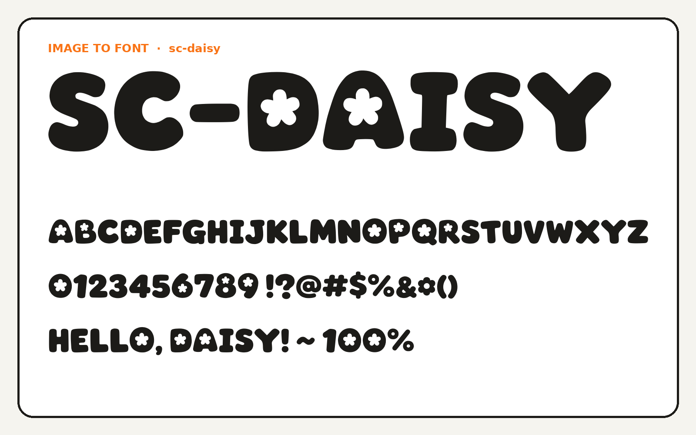
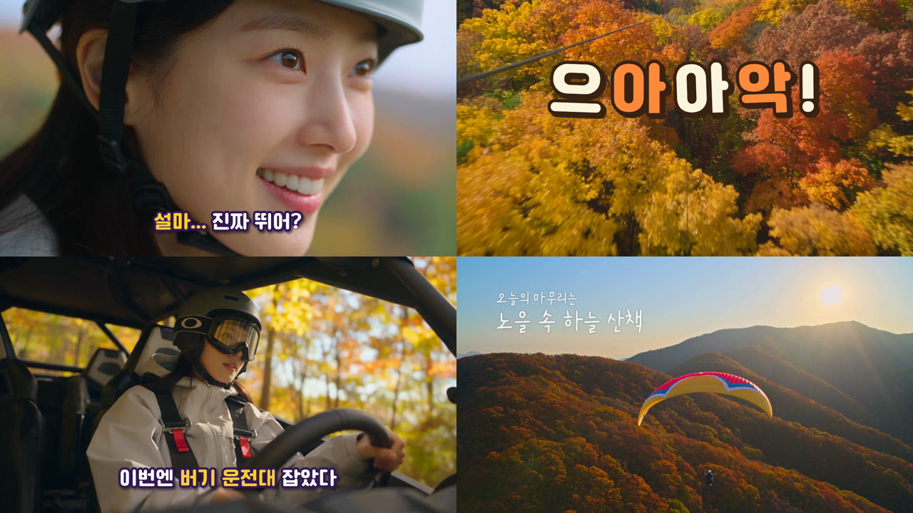

# 쌩초의 AI 스킬 나눔 🌼

AI 디자인 크리에이터 **쌩초(@ssaengcho)** 가 직접 만들어 쓰는 Claude/GPT 스킬 파일을 나눠요.

## 스킬 목록

<table>
<tr>
<td align="center" valign="top" width="50%">
 
<b><a href="./stopmotion-collage-edit">스톱모션 콜라주 편집</a></b> 
내 영상을 12fps 스톱모션 + 종이 콜라주 스크랩북 스타일로
</td>
<td align="center" valign="top" width="50%">
 
<b><a href="./painterly-animation">회화 애니메이션</a></b> 
three.js 코드로 직접 그리는 붓터치 회화풍 2.5D 영상
</td>
</tr>
<tr>
<td align="center" valign="top" width="50%">
 
<b><a href="./zoom-in-screen">화면 녹화 줌 편집</a></b> 
꼭 필요한 곳만 확대, 진짜 클릭에만 빨간 박스
</td>
<td align="center" valign="top" width="50%">
 
<b><a href="./video-storyboard">영상 스토리보드 편집기</a></b> 
재생되는 스토리보드에 씬별로 고칠 점 적고 바로 반영
</td>
</tr>
<tr>
<td align="center" valign="top" width="50%">
 
<b><a href="./image-to-fonts">이미지로 폰트 만들기</a></b> 
폰트 견본 시트 이미지를 설치 가능한 .otf 폰트로
</td>
<td align="center" valign="top" width="50%">
 
<b><a href="./variety-captions">예능 자막 하이라이트</a></b> 
클립 여러 개를 짧게 묶고 통통 튀는 예능 자막까지
</td>
</tr>
<tr>
<td align="center" valign="top" width="50%">
 
<b><a href="./daily-work-log">날짜별 누적 업무일지</a></b> 
하루 기록을 시간대별 업무일지로, HTML 한 파일에 날짜별로 쌓기
</td>
<td></td>
</tr>
</table>

## 설치 방법 (Claude/GPT)

**① 링크로 바로 설치 (가장 쉬움)**
설치하고 싶은 스킬의 링크를 복사해서 Claude/GPT에 붙여넣고 "이 스킬 설치해줘"라고 말하세요.
[쌩초 링크 페이지](https://litt.ly/ssaengcho)의 스킬 나눔 메뉴에서 `스킬 링크 복사` 버튼으로도 복사할 수 있어요.

> 예: `https://github.com/ssaengcho01/ssaengcho/tree/main/stopmotion-collage-edit 이 스킬 설치해줘`

**② 안 되면 ZIP으로 설치**
1. [ZIP 내려받기](https://github.com/ssaengcho01/ssaengcho/archive/refs/heads/main.zip) (또는 이 페이지 위쪽 초록색 **Code → Download ZIP**)
2. Claude/GPT의 스킬(설정) 메뉴에 업로드하거나, 채팅창에 ZIP을 넣고 "이 스킬 설치해줘"라고 말해요.

**③ 말로 실행**
채팅에서 "이 영상 스톱모션 콜라주로 편집해줘"처럼 요청하면 스킬이 알아서 작동해요.

## 이용 안내

- 개인 공부·작업용으로 자유롭게 쓰세요.
- 다시 공유하거나 활용할 때는 꼭 **@ssaengcho** 출처를 남겨 주세요.

---

🔗 [쌩초 링크 모음](https://litt.ly/ssaengcho) · [Threads](https://www.threads.net/@ssaengcho) · [Instagram](https://www.instagram.com/ssaengcho) · [YouTube](https://www.youtube.com/@ssaengcho)
