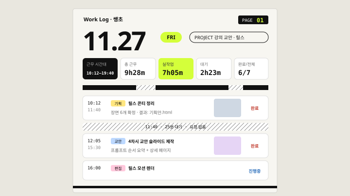

# 날짜별 누적 업무일지

"오늘 업무일지 정리해줘"라고 말하면, 그날 대화·작업 기록을 읽어 시간대별 업무일지를 만들고 HTML 파일 하나에 날짜별로 계속 쌓아 줘요. 근무·실작업·대기 시간 계산, 하루 흐름 막대, 결과물 썸네일, 내일 할 일까지 한 장에 정리돼요.

## 설치 방법

1. 아래 링크를 복사해서 Claude/GPT 채팅창에 붙여넣고 "이 스킬 설치해줘"라고 말하세요.
   `https://github.com/ssaengcho01/ssaengcho/tree/main/daily-work-log`
2. 설치가 안 되면 [ZIP 내려받기](https://github.com/ssaengcho01/ssaengcho/archive/refs/heads/main.zip) 후 스킬(설정) 메뉴에 이 폴더를 업로드하세요.
3. 채팅에서 "오늘 업무일지 정리해줘" 또는 "11월 26일 업무일지 정리해줘"처럼 말하면 스킬이 작동해요.

> 💡 누적 파일 경로(`E:\#업무일지\업무일지_누적.html`)와 작성자 이름(쌩초)은 쌩초 기준이에요. SKILL.md에서 내 폴더 경로와 이름으로 바꿔 쓰세요.

다시 공유하거나 활용할 때는 **@ssaengcho** 출처를 남겨 주세요. · [전체 스킬 보기](../)
