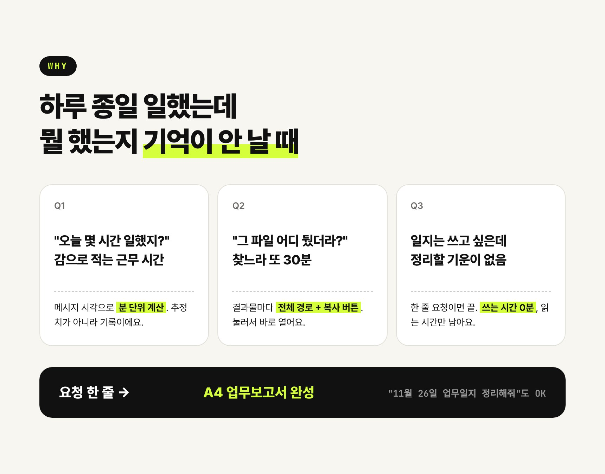
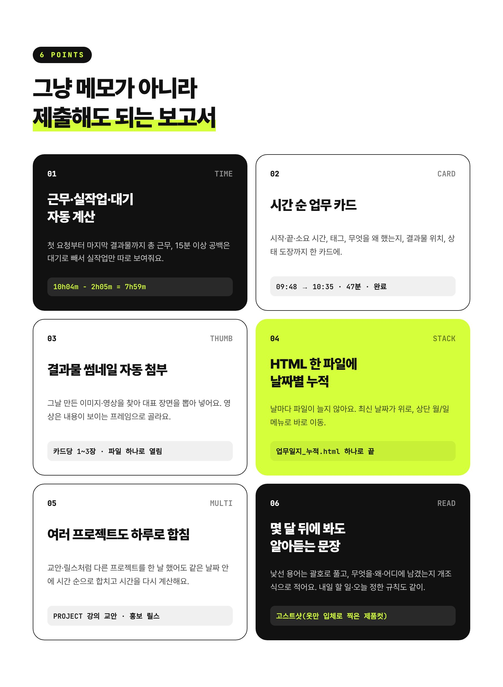
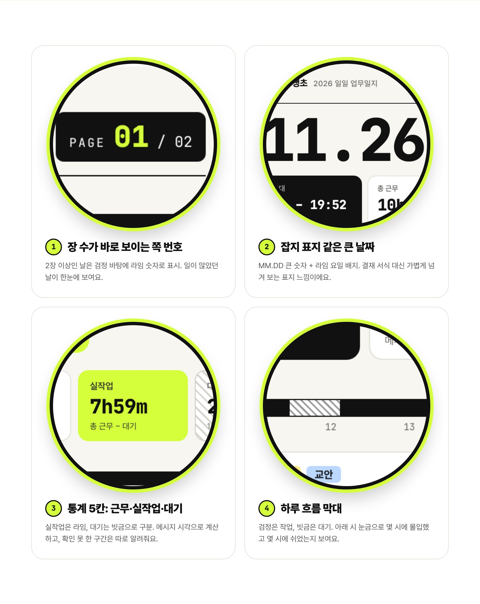
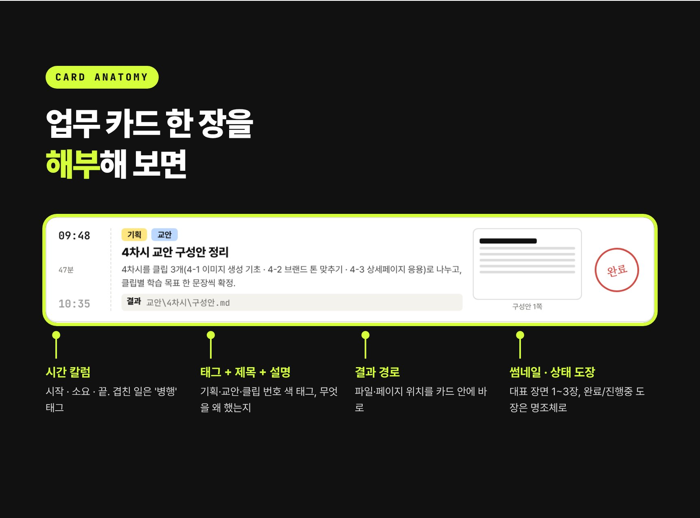
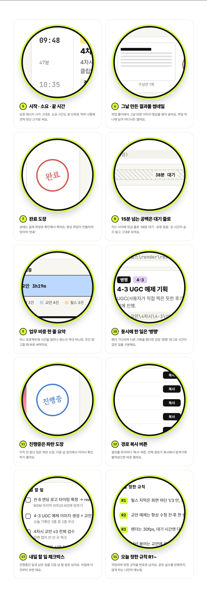
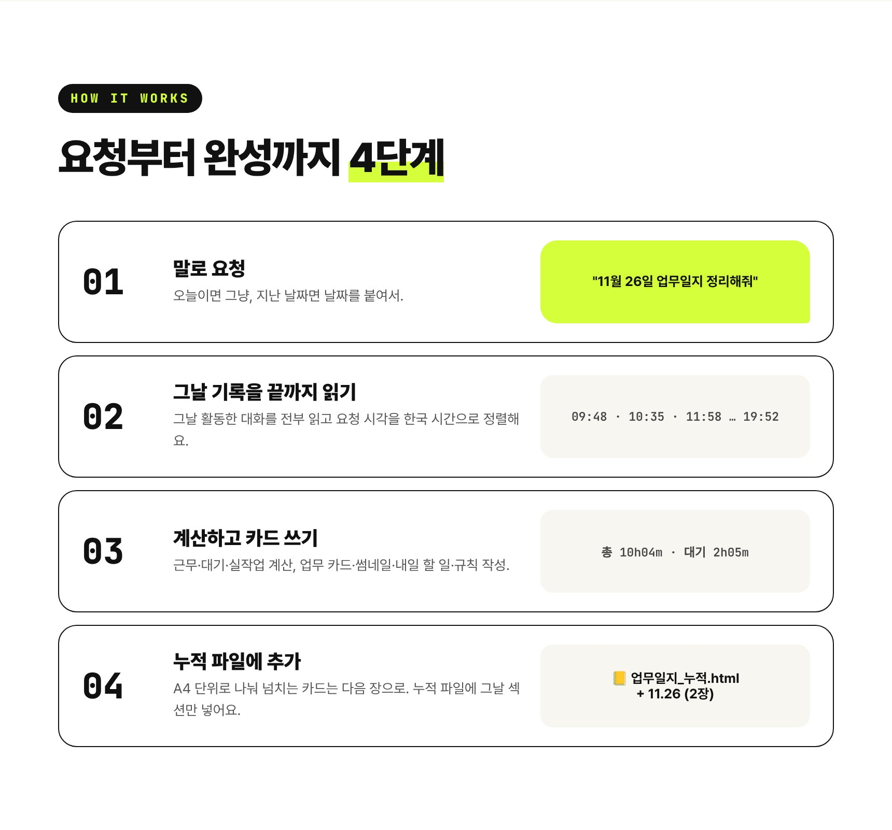
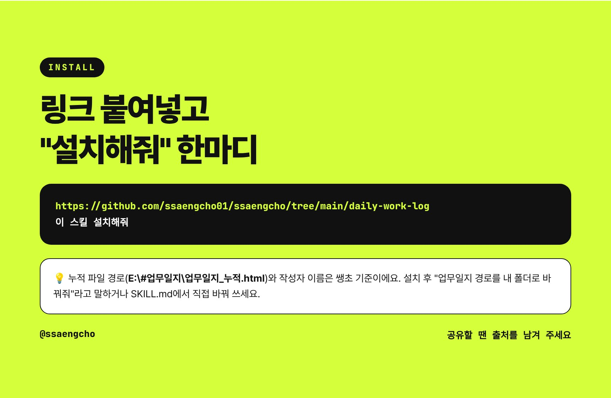
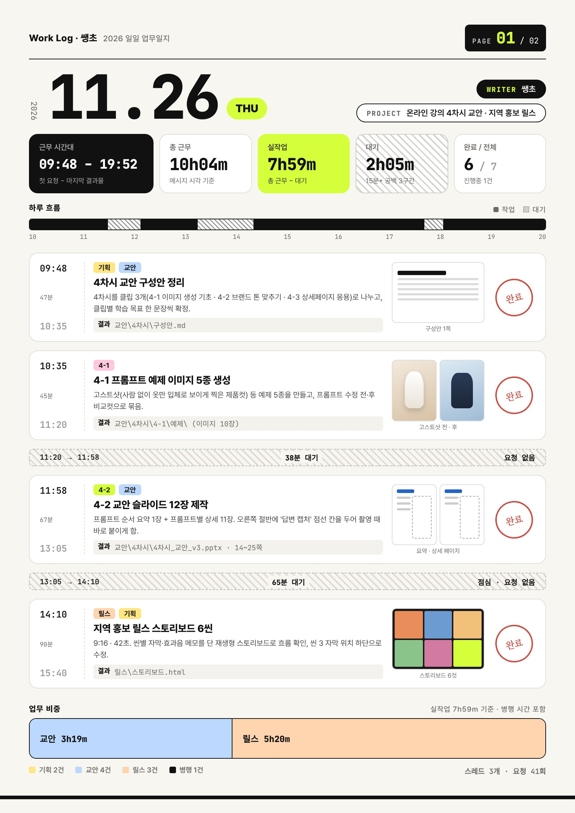
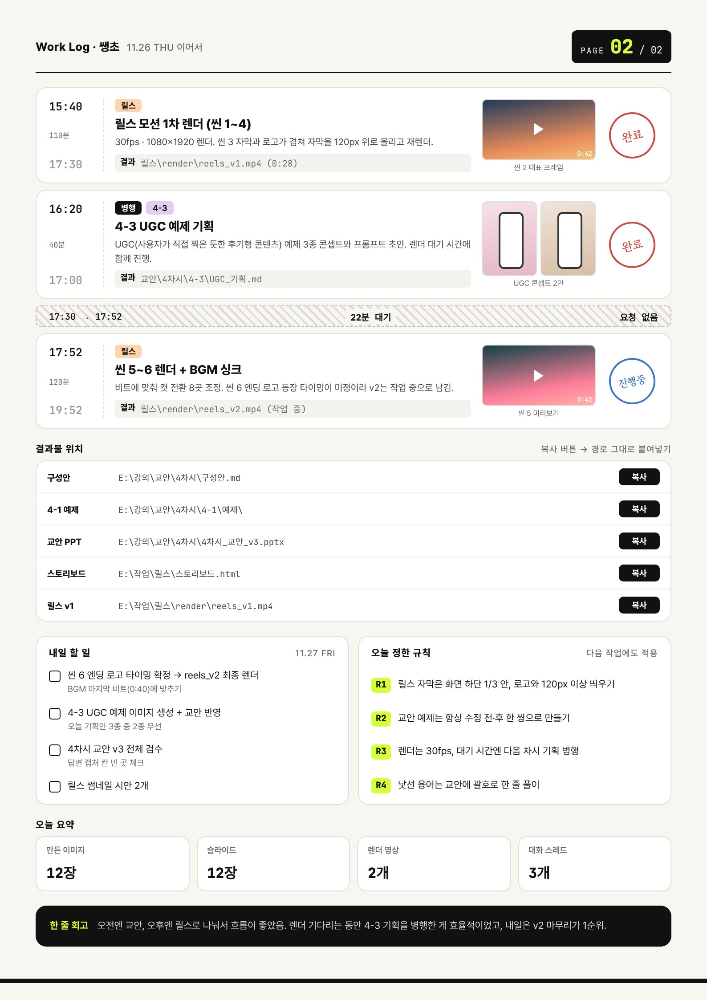

# 날짜별 누적 업무일지

"오늘 업무일지 정리해줘" 한마디면, 그날 대화·작업 기록을 읽어 **실제 업무보고서 같은 A4 일지**를 만들고 HTML 파일 하나에 날짜별로 계속 쌓아 줘요.

## 실제 결과물 예시 (A4 2장)

| 1쪽 | 2쪽 |
|---|---|
|  |  |

> 예시는 설명용으로 꾸민 하루예요. 실제 일지는 그날 내 기록으로 채워져요.

## 이런 게 들어가요

- **통계 5칸**: 근무 시간대 · 총 근무 · 실작업 · 대기 · 완료/전체 (메시지 시각으로 계산)
- **하루 흐름 막대**: 작업(검정)과 대기(빗금)를 시 눈금 위에
- **시간 순 업무 카드**: 시작·소요·끝, 색 태그, 무엇을 왜 했는지, 결과물 위치, 썸네일, 완료/진행중 도장
- **대기 줄**: 15분 넘는 공백은 카드 사이에 빗금 줄로
- **병행 표시**: 시간이 겹친 일은 '병행' 태그
- **결과물 위치 + 복사 버튼**, **내일 할 일 체크박스**, **오늘 정한 규칙 R1~**, 업무 비중, 한 줄 회고
- **누적 파일 하나**: 최신 날짜가 위로, 상단 월/일 메뉴 자동 생성, 모서리부터 말리는 책 넘김 + 종이 소리

## 설치 방법

1. 아래 링크를 복사해서 Claude/GPT 채팅창에 붙여넣고 "이 스킬 설치해줘"라고 말하세요.
   `https://github.com/ssaengcho01/ssaengcho/tree/main/daily-work-log`
2. 설치가 안 되면 [ZIP 내려받기](https://github.com/ssaengcho01/ssaengcho/archive/refs/heads/main.zip) 후 스킬(설정) 메뉴에 이 폴더를 업로드하세요.
3. 채팅에서 "오늘 업무일지 정리해줘" 또는 "11월 26일 업무일지 정리해줘"처럼 말하면 스킬이 작동해요.

> 💡 누적 파일 경로(`E:\#업무일지\업무일지_누적.html`)와 작성자 이름(쌩초)은 쌩초 기준이에요. 설치 후 "업무일지 경로를 내 폴더로 바꿔줘"라고 말하거나 SKILL.md에서 직접 바꿔 쓰세요.

다시 공유하거나 활용할 때는 **@ssaengcho** 출처를 남겨 주세요. · [전체 스킬 보기](../)
