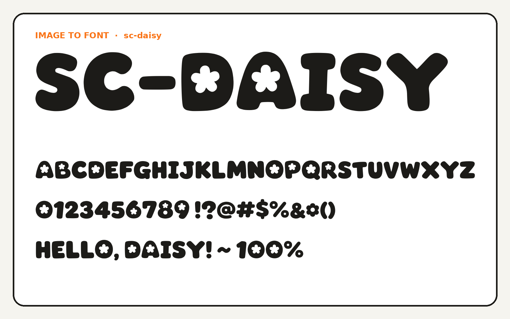

# 이미지로 폰트 만들기

알파벳·숫자·기호를 그린 **폰트 견본 시트 이미지**를 올리면, 그 모양 그대로 설치할 수 있는 **.otf 폰트 파일**로 만들어 줘요. 오버슈트나 꼬리 장식 같은 디테일도 따라 그리고, 자간·커닝도 자동으로 잡아요. 결과물로 폰트 파일과 함께 글자표·직접 써보기·다운로드 버튼이 있는 미리보기 HTML을 줘요. 마음에 안 드는 글자는 그 글자만 크게 찍어 올리면 그것만 바꿔 줘요.

## 설치 방법

1. 아래 링크를 복사해서 Claude/GPT 채팅창에 붙여넣고 "이 스킬 설치해줘"라고 말하세요.
   `https://github.com/ssaengcho01/ssaengcho/tree/main/image-to-fonts`
2. 설치가 안 되면 [ZIP 내려받기](https://github.com/ssaengcho01/ssaengcho/archive/refs/heads/main.zip) 후 스킬(설정) 메뉴에 이 폴더를 업로드하세요.
3. 채팅에서 견본 시트 이미지를 첨부하고 "이걸 폰트 파일로 만들어줘, 폰트 이름은 ○○"처럼 말하면 스킬이 작동해요.

> 잘 나오게 하는 팁: 흰 배경에 검정 글자, 글자 높이 300px 이상. 대문자·소문자·숫자·기호를 여러 장으로 나눠 올려도 하나의 폰트로 합쳐요.
> 상용 폰트 견본을 떠서 만드는 건 개인 공부용으로만 쓰세요.

예시 폰트 `sc-daisy`는 [examples](./examples) 폴더에서 받아 볼 수 있어요 (`sc-daisy.otf`, 미리보기 `sc-daisy_preview.html`).

다시 공유하거나 활용할 때는 **@ssaengcho** 출처를 남겨 주세요. · [전체 스킬 보기](../)
