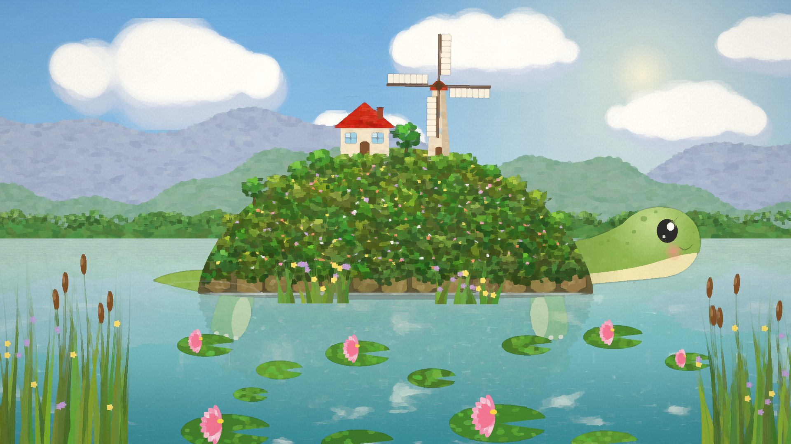

# 회화 애니메이션

AI 생성 도구 없이 three.js 코드로 직접 그리는 붓터치 회화풍 2.5D 애니메이션·광고 영상을 만들어요. 컷별 시안을 먼저 보여주고 확인받은 뒤 렌더해요. 위 이미지는 쌩초의 자라섬 광고 한 장면이에요.

## 설치 방법

1. 아래 링크를 복사해서 Claude/GPT 채팅창에 붙여넣고 "이 스킬 설치해줘"라고 말하세요.
   `https://github.com/ssaengcho01/ssaengcho/tree/main/painterly-animation`
2. 설치가 안 되면 [ZIP 내려받기](https://github.com/ssaengcho01/ssaengcho/archive/refs/heads/main.zip) 후 스킬(설정) 메뉴에 이 폴더를 업로드하세요.
3. 채팅에서 "회화 애니메이션으로 우리 가게 광고 만들어줘"처럼 말하면 스킬이 작동해요.

다시 공유하거나 활용할 때는 **@ssaengcho** 출처를 남겨 주세요. · [전체 스킬 보기](../)
