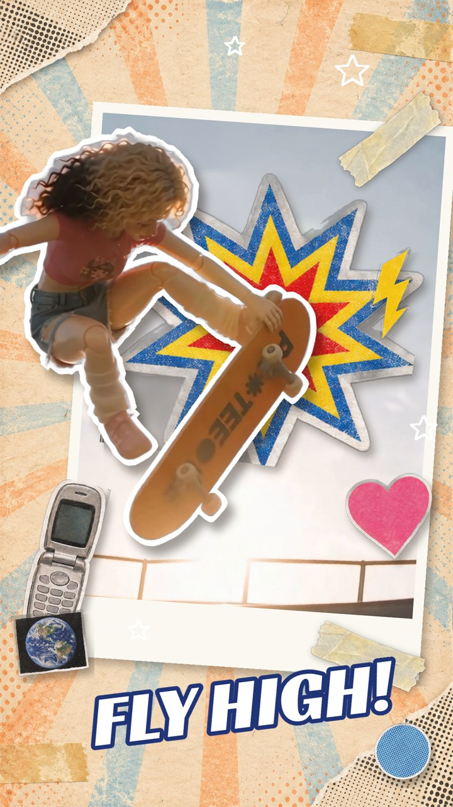

# 스톱모션 콜라주 편집

내 영상을 12fps 스톱모션 + 종이 콜라주 스크랩북 스타일로 편집해요. 오린 단어 조각, 손낙서, 낡은 폴라로이드, 종이 질감까지 한 번에 들어가요.

## 설치 방법

1. 아래 링크를 복사해서 Claude/GPT 채팅창에 붙여넣고 "이 스킬 설치해줘"라고 말하세요.
   `https://github.com/ssaengcho01/ssaengcho/tree/main/stopmotion-collage-edit`
2. 설치가 안 되면 [ZIP 내려받기](https://github.com/ssaengcho01/ssaengcho/archive/refs/heads/main.zip) 후 스킬(설정) 메뉴에 이 폴더를 업로드하세요.
3. 채팅에서 "이 영상 스톱모션 콜라주로 편집해줘"처럼 말하면 스킬이 작동해요.

다시 공유하거나 활용할 때는 **@ssaengcho** 출처를 남겨 주세요. · [전체 스킬 보기](../)
