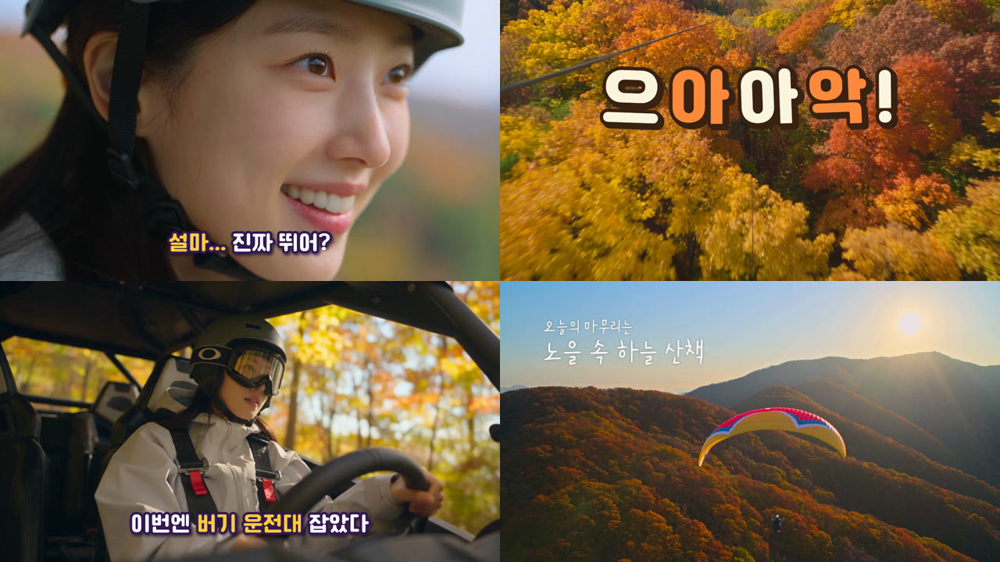

# 예능 자막 하이라이트

영상 클립 여러 개를 짧은 하이라이트로 잘라 붙이고, 예능 스타일 자막을 입혀요. 글자가 하나씩 튀어나오는 효과음 자막, 노랑·흰 하단 자막, 은은한 손글씨 엔딩까지 한 번에 들어가요. 브이로그, 여행, 일상, 제품 소개, AI로 만든 영상 등 주제는 가리지 않아요.

수정은 채팅으로 말하면 되고, 멘트만 바꾸고 싶으면 결과 폴더의 `자막_멘트.txt`를 메모장으로 열어 장면별 문구만 고치면 돼요.

## 설치 방법

1. 아래 링크를 복사해서 Claude/GPT 채팅창에 붙여넣고 "이 스킬 설치해줘"라고 말하세요.
   `https://github.com/ssaengcho01/ssaengcho/tree/main/variety-captions`
2. 설치가 안 되면 [ZIP 내려받기](https://github.com/ssaengcho01/ssaengcho/archive/refs/heads/main.zip) 후 스킬(설정) 메뉴에 이 폴더를 업로드하세요.
3. 채팅에서 "이 영상들 15초로 묶고 예능 자막 넣어줘"처럼 말하면 스킬이 작동해요.

다시 공유하거나 활용할 때는 **@ssaengcho** 출처를 남겨 주세요. · [전체 스킬 보기](../)
