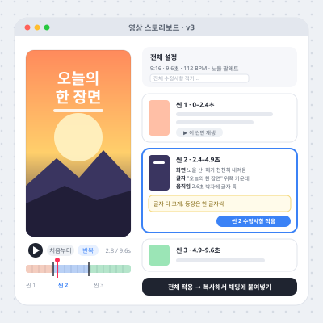

# 영상 스토리보드 편집기

모션그래픽·키네틱 타이포·릴스 같은 짧은 영상을 바로 뽑지 않고, **재생되는 스토리보드**를 먼저 만들어요. 왼쪽 플레이어로 전체나 씬 하나만 돌려 보고, 오른쪽 씬 카드에 고칠 점을 적은 뒤 [적용]을 누르면 수정사항이 복사돼요. 채팅에 붙여 넣으면 말한 씬만 고쳐 주고, 마음에 들면 그대로 영상으로 뽑아 줘요.

## 설치 방법

1. 아래 링크를 복사해서 Claude/GPT 채팅창에 붙여넣고 "이 스킬 설치해줘"라고 말하세요.
   `https://github.com/ssaengcho01/ssaengcho/tree/main/video-storyboard`
2. 설치가 안 되면 [ZIP 내려받기](https://github.com/ssaengcho01/ssaengcho/archive/refs/heads/main.zip) 후 스킬(설정) 메뉴에 이 폴더를 업로드하세요.
3. 채팅에서 "이 문구로 9:16 모션그래픽 스토리보드 만들어줘"처럼 말하면 스킬이 작동해요.

다시 공유하거나 활용할 때는 **@ssaengcho** 출처를 남겨 주세요. · [전체 스킬 보기](../)
